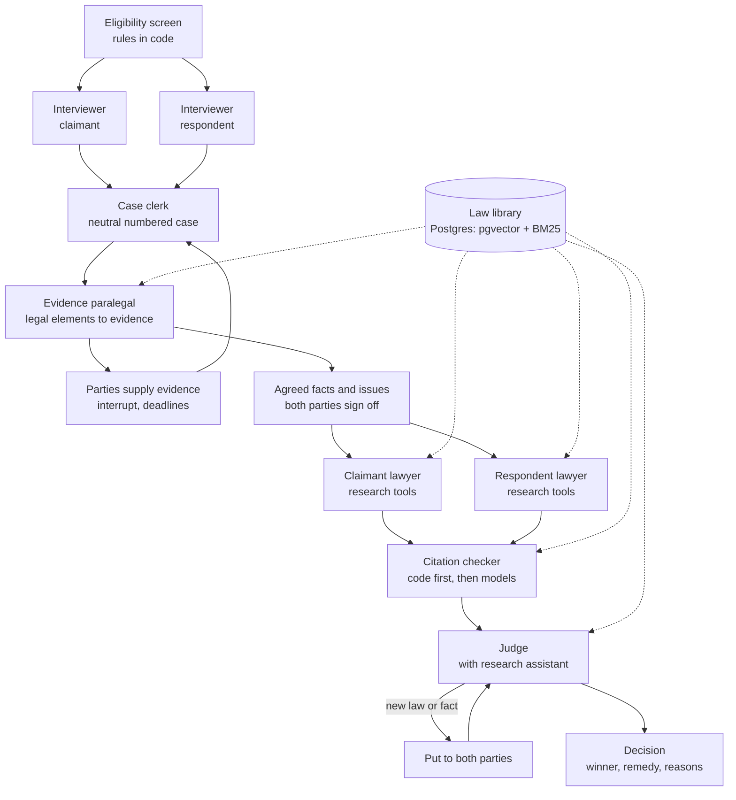

# Alteram v1: design for the next iteration

Status: proposal for review by Gabriel, then input to a coordinator agent that turns it into repo steps.
Date: 27 October 2026.
Author: Claude (architecture advisory), based on the v0 repo at commit `5c2c1f7` and the design conversation of 26–27 October 2026.

---

## 0. How to read this document

This document describes what Alteram v1 should be, why, and in what order to build it. It is written so that a coordinator agent can turn it into a step plan in the style of `ALTERAM_SETUP_BRIEF.md` section 8, with one "done when" condition per step.

Three kinds of statement appear below, and the coordinator should keep them apart:

- **Decided** means recommended here and not expected to change unless Gabriel says so. These can go straight into the plan.
- **Default** means a reasonable choice with a named alternative. The plan can use it, but should record it in `docs/SETUP_LOG.md` under Decisions so it can be revisited.
- **Open** means Gabriel must decide before the step that depends on it. Section 15 lists every open question with the step it blocks.

Everything in `AGENTS.md` still applies. In particular: Claude Code writes the code; prompts are versioned and changed only through the `prompt-change` skill; cases are written and checked with the `new-case` skill; `.env` is never read; and no real party data is used until the WSL2 and sandbox decision from 25 October has been carried out. v1 is built and tested on synthetic cases only.

---

## 1. Where v0 stands

v0 completed steps 1 to 9 of the setup brief. It is a LangGraph graph with two lawyer agents (Sonnet 5.5) running in parallel and a judge (Opus 5.5), reading a hand-written numbered case. Code, not the models, assigns point labels, checks paragraph citations, checks that the judge gives one reason per point, and checks the labels of unsupported claims. Refusals and truncation are hard failures; failed checks get one retry. Every run is logged with case and prompt hashes. 71 tests pass and ruff is clean.

Four things must be finished before any v1 work starts. They form milestone M0 in section 14.

1. **Judge v2 regression.** Judge prompt v2 introduced the labels `C-outcome`, `C-against`, `R-outcome` and `R-against` for unsupported claims. In the v2 swap runs of 26 October, 15 of 20 judge calls failed their first check, all for the same reason: the judge also used `C-against` and `R-against` in `reasons`, and `check_reason_coverage` rejects any reason label that is not a numbered point. All 20 passed on retry, so the judge now costs almost double. Recommended fix (v3): accept the four part labels in `reasons` as optional (neither required nor counted as unknown), and add one sentence to the judge prompt saying reasons must cover every numbered point and may also cover the outcome and counterpoint labels. Re-run the swap on all four cases and record the decision in `docs/prompt-log.md`.
2. **Step 10, CI.** GitHub Actions running `uv run pytest` and `uv run ruff check .` on every push.
3. **Step 11, README.**
4. **Step 12, retrospective**, recorded in `docs/SETUP_LOG.md`.

One security note: the zip of the repo shared on 27 October contained `.env`. The key in it should be rotated. Future exports should use `git archive -o alteram.zip HEAD`, which includes only tracked files.

---

## 2. What v1 is for

### 2.1 Goals

v1 takes a dispute from first contact to a reasoned decision, end to end, with every stage observable. Specifically:

1. **A full case lifecycle.** Eligibility screen, separate interviews of each party, a neutral case written by a clerk, a neutral evidence-gathering loop, an agreed-facts-and-issues stage, lawyers who research the law, a citation checker, and a judge who decides with a remedy.
2. **A law library** of statutes, regulations, FCA rules and ombudsman decisions, stored with metadata and embeddings, and retrieved by hybrid search with reranking and a relevance gate.
3. **Verification that code can audit.** Lawyers and judge may cite only provisions that exist in the library, as in force on the relevant date, with quotations that match the stored text exactly. A semantic check then tests whether each passage supports the proposition it is cited for.
4. **A developer console**: a small local web app where Gabriel can play the claimant, the respondent, or both, by typing or speaking, and watch every agent's inputs, outputs, tool calls, verification results and costs as the case moves through its stages.
5. **An evaluation harness** (`alteram eval`) that scores every stage, so each change can be compared against a baseline.

### 2.2 Non-goals for v1

- Real users or real personal data. Synthetic cases only.
- Binding decisions, payments, or enforcement.
- Accounts, multi-user auth, or multi-tenancy. The console is single-user.
- Motor finance commission complaints. The FCA's industry redress scheme covers these (PS26/3, 30 March 2026). Parts of it have been legally challenged, and at least one lender expects the outcome in early 2027. Alteram should route these complaints out, not decide them.
- Jurisdictions other than England and Wales.
- Production hosting. Deployment to Google Cloud is the last milestone and optional.

### 2.3 Dispute scope

Consumer disputes about the quality of a motor vehicle supplied under a conditional sale or hire purchase agreement, in England and Wales, where the respondent is the finance company. This matches the v0 cases and the respondent convention in `docs/SETUP_LOG.md`. Under these agreements the finance company is the supplier, so the Consumer Rights Act 2015 applies to it directly.

---

## 3. Design principles

These follow from what v0 taught and from the research in section 7. Every component below should be checked against them.

1. **Code checks what code can check.** Existence of a citation, whether a provision was in force on a date, whether a quotation matches stored text, label validity, date arithmetic, deadlines and budgets are all code. Models are used only for judgement. This is v0's strongest property; v1 extends it from paragraph citations to law.
2. **Closed-world citation.** An agent can cite a legal source only by its library ID. A citation that is not in the library cannot be expressed, so an invented statute fails at the schema, not at review.
3. **Neutral tribunal, partisan advocates.** The interviewer, clerk, evidence paralegal, citation checker and judge's assistant all work for the tribunal and treat both sides identically. Only the two lawyers take a side, and they get identical tools, budgets and models.
4. **Equality of arms is measured, not assumed.** Every tool call, retrieval and token is logged per side, and eval reports them by side.
5. **Agreed facts are settled; disputed facts are decided.** Once both parties agree a fact, the judge treats it as found. The judge's reasoning goes into what is disputed.
6. **Audi alteram partem.** If the judge wants to rely on law or a fact that neither side raised, both sides get to respond first. The product is named after this rule; the architecture should enforce it.
7. **Append-only case record.** Case paragraphs are never renumbered or rewritten. New material adds paragraphs, and each version of the case gets a hash. Old citations stay valid.
8. **Everything is an event.** Every agent step emits a typed event that is stored and streamed. The console, the run logs and eval all read the same event stream.
9. **Party content is data, never instructions.** Interview answers, uploaded documents and comments may contain text that looks like instructions. Every agent that reads party content is told so, and no party content can change tools, budgets or stage transitions.
10. **Measure the error that matters.** For any verifier, the headline metric is the false verification rate (how often it passes something that is not supported), not overall accuracy. Sections 7.1 and 7.2 explain why.

---

## 4. Architecture overview

### 4.1 The flow



### 4.2 Case lifecycle states

A case moves through these states. Each is a LangGraph subgraph, and each transition emits a `state_change` event. The state is stored on the case row as well as in the checkpointer, so the console can list cases by state without loading graphs.

| State | Entered when | Leaves when | Waits for a human? |
| --- | --- | --- | --- |
| `screening` | Claimant starts | Rules pass or fail | Yes, claimant answers screening questions |
| `out_of_scope` | Rules fail | Terminal | No |
| `claimant_interview` | Screening passes | Claimant confirms their statement | Yes |
| `respondent_invited` | Claimant statement confirmed | Respondent accepts, declines, or deadline passes | Yes |
| `respondent_declined` | Respondent declines or ignores | Terminal; claimant receives a case file | No |
| `respondent_interview` | Respondent accepts | Respondent confirms their statement | Yes |
| `case_drafting` | Both statements confirmed | Clerk's case passes checks | No |
| `evidence_round_n` | Case drafted | All decisive requests resolved, or round limit reached | Yes, deadlines |
| `agreeing_facts` | Evidence closed | Both parties have marked every paragraph and document | Yes |
| `arguing` | Agreed facts recorded | Both arguments pass citation checks (or retry exhausted) | No |
| `deciding` | Arguments checked | Verdict passes checks | Only if something is put to the parties |
| `put_to_parties` | Judge raises new law or fact | Both lawyers respond | No (lawyers respond, not parties) |
| `decided` | Verdict recorded | Terminal | No |

In v1 the "human" is Gabriel in the console or a simulated party (section 5.10).

### 4.3 Models

| Role | Model | Why |
| --- | --- | --- |
| Interviewer | `claude-sonnet-5-5` | Conversational latency; judgement about follow-up questions |
| Statement summariser (end of interview) | `claude-sonnet-5-5` | Structured output from a transcript |
| Case clerk | `claude-opus-5-5` | Neutral drafting across two accounts is the hardest writing task in the pipeline |
| Evidence paralegal | `claude-sonnet-5-5` | Works from a fixed legal-test template; mostly mapping |
| Lawyers | `claude-sonnet-5-5` | As v0 |
| Judge | `claude-opus-5-5` | As v0 |
| Judge's research assistant | `claude-sonnet-5-5` | Retrieval and summarising |
| Semantic citation check | `claude-sonnet-5-5` plus Jev | See section 7.4 |
| Relevance gate, neutrality checks, cheap classifications | Jev (`jev-1.13.0`, pinned) with `claude-haiku-5-5` as fallback | Calibrated probabilities at low cost |
| Contextual chunk headers at ingestion | `claude-haiku-5-5` | One call per chunk, run once |
| Simulated parties | `claude-sonnet-5-5` | See section 5.10 on circularity |

Model IDs stay in `.env` as now (`ALTERAM_LAWYER_MODEL`, `ALTERAM_JUDGE_MODEL`), with new variables for each new role. Every call is logged with configured and reported model, prompt version and hash, as in v0.

---

## 5. The agents and stages

Each subsection gives the role, inputs, outputs, what code checks, the main failure modes, and how eval measures it. Schemas are sketches for Pydantic models in `src/alteram/models.py`; field names can change, but every field listed should exist in some form.

### 5.1 Eligibility screen (code, no model)

**Role.** Decide whether a dispute is in scope before any model sees it, and route it elsewhere if not.

**How.** A short form of closed questions with fixed answers: what was bought, how it was paid for, in which UK nation, when the agreement was signed, when the fault appeared, whether a complaint has been made to the business, whether it is already with the Financial Ombudsman or a court, and whether the complaint is about commission. Rules in `src/alteram/eligibility.py` decide `in_scope`, `out_of_scope` (with a reason and a referral), or `needs_review`.

**Why code.** A deterministic screen is cheaper, cannot be argued with by a party, and can be audited line by line. The interviewer should never be the one deciding scope.

**Rules to include in v1.** Vehicle supplied under conditional sale or hire purchase; England and Wales; not already decided by the ombudsman or a court; not a commission complaint (refer to the FCA redress scheme); a value cap (open question, section 15); and time limits. The time-limit rules must be written from the provisions themselves once they are in the law library (the FCA's DISP rules for ombudsman time limits, and the Limitation Act 1980), and each rule should store the library ID of the provision it implements, so a change in the law shows up as a failing test.

**Also at this stage: identify the respondent.** Claimants often name the dealer. For conditional sale and hire purchase, the respondent is the finance company. The screen asks for the finance company's name from the agreement and, in a later milestone, checks it against the Companies House API and the FCA Financial Services Register. In v1 these lookups use fixtures.

**Eval.** A table of synthetic screening inputs with expected outcomes, tested in pytest. No model involved.

### 5.2 Interviewer (one per party)

**Role.** Collect one party's account and desired outcome, neutrally. It does not advise, argue, assess strength, or tell the party what the other side said.

**Inputs.** The screening answers; a question plan generated from the legal-test template for the dispute type (section 5.4); for the respondent, the clerk's neutral summary of the claim (not the claimant's transcript).

**Conversation.** Free-text turns, streamed. The interviewer works through the question plan but follows up where an answer is vague, especially on dates, documents and who said what. Both interviewers use the same question plan, so neither side is asked more probing questions than the other.

**Output (`PartyStatement`).**

- `party`: claimant or respondent.
- `facts`: list of `{id, text, date?, source_turn_ids[]}`. Each fact must point to the transcript turns it came from.
- `documents_mentioned`: list of `{description, held_by, source_turn_ids[]}`.
- `desired_outcome`: free text plus one of a fixed set of remedies (reject and refund, repair, price reduction, damages, other).
- `unknowns`: things the party said they don't know.
- `vulnerability_flags`: set when the party shows signs of distress or difficulty, for the console to show. Not shown to any other agent.

The party then sees the statement and confirms it or asks for corrections. The confirmed statement, not the transcript, is what goes to the clerk.

**Code checks.**

- Every fact has at least one `source_turn_id`, and every ID exists in the transcript.
- A cheap check (Jev, or Haiku as fallback) that each fact is supported by its source turns. This catches facts the summariser added.
- Interview length limits: maximum turns and maximum tokens per session.

**Prompt rules.** States in the first message that the interviewer is neutral and is not the party's lawyer. Treats party text as data. Never quotes or paraphrases the other side's statement. Never gives legal advice or predicts the outcome; if asked, says that it can't and continues.

**Failure modes and eval.** Leading questions; asking one side more probing questions than the other; adding facts the party didn't say; missing a decisive fact. Measured with simulated parties (section 5.10): the share of hidden facts the interviewer elicits, the leading-question rate (a classifier over interviewer turns), the rate of unsupported facts in the statement, and the number of questions per side.

### 5.3 Case clerk

**Role.** Turn two confirmed statements, and any evidence received, into one neutral case in the existing format: numbered paragraphs, one fact per paragraph, with each party's claims attributed ("Mr D says that...").

This is the stage that lets v1 reuse everything downstream. Its output is a `Case` that the existing lawyers and judge already understand.

**Output.** The v0 `Case` model, extended:

- Each paragraph gains `status` (one of `undisputed_document`, `claimant_says`, `respondent_says`, `both_say`) and `provenance` (statement fact IDs, or document ID and page).
- `version` and `sha256` for each case version.
- Paragraph [1] names the claimant and the respondent, as now.

**Append-only rule.** After the first version, the clerk can only add paragraphs. A correction is a new paragraph ("On 3 March Mr D corrected his account of..."), never an edit. Code enforces this by comparing the new version with the previous one: every earlier paragraph must be byte-identical and keep its number.

**Code checks.** Every paragraph has provenance, and every provenance ID exists. The existing `new-case` checks run automatically (numbering, one fact per paragraph, parties in [1], delivery date present). A neutrality classifier flags paragraphs that contain argument or characterisation ("unreasonably", "clearly", "admits"), and flagged paragraphs are sent back to the clerk once.

**Testing the clerk against v0.** Write `PartyStatement` fixtures derived from the four existing cases. The clerk's output should contain every fact of the original case. Diff it against the hand-written case to see what it adds, drops or slants. This is the cheapest test of the whole front end and should be the first thing built in milestone M8.

### 5.4 Evidence paralegal and the evidence loop

**Role.** A neutral case-management paralegal, working for the tribunal rather than for either side. It works out what evidence each legal test needs, asks whichever party holds each item, and keeps a status for every item until the loop closes.

**Legal-test templates (new, versioned data).** For each dispute type, a YAML file in `law/tests/` lists the legal elements and the evidence that typically proves each one. For a Consumer Rights Act quality claim on a car, the elements include: the contract and its date; the delivery date; the description, price, age and mileage at supply; the fault and when it first appeared; whether it was present at delivery; and what the respondent did when told, including any repair attempt. Each element names the library IDs of the provisions it comes from. These templates are written once, reviewed by Gabriel, and changed through a skill like `prompt-change`. The paralegal applies a template to a case; it does not invent the legal test each time. That makes its requests checkable and stops it from going on a fishing expedition.

**Output per round (`EvidenceRequest` list).** Each request has `id`, `element_id` (must exist in the template), `addressed_to` (the party believed to hold the item), `kind` (document or clarification), `priority` (decisive or supporting), `why` (one sentence), and `deadline`.

**Party responses (`EvidenceResponse`).** One of: `provided` (upload or answer), `not_held` (with a reason), `objected` (with a reason), or `no_response` (set by code when the deadline passes).

**Loop rules (code).**

- Both parties see every request and every response. This mirrors disclosure.
- Every request must name an `element_id` from the template. Requests that don't are rejected.
- Maximum requests per round (default 6) and maximum rounds (default 2, open question).
- After each response, the clerk appends paragraphs describing the new material neutrally ("The job card dated 3 March 2026 records..."), and the other party may comment; comments are attributed.
- The paralegal then marks each request `satisfied`, `not_held`, `objected`, or `outstanding`. Code computes completeness. A model is used only to judge whether a given document satisfies a given request.
- The loop closes when every decisive request is resolved (satisfied, not held, or objected), or when the round limit is reached. Anything still outstanding at the deadline becomes a paragraph: "Ashby Vehicle Finance did not provide the job card by 14 November 2026." The judge applies the burden of proof and may draw an inference. Delay therefore has a cost inside the process, which answers the weakness raised in the first design conversation: the likely loser otherwise benefits from stalling.

**Documents.** Uploaded files go to object storage (section 9). Text and images are extracted with Claude's native PDF and image input, page by page, and each extracted fact keeps its page reference. Uploaded documents are untrusted: they are passed to models inside clearly marked data blocks, and any instruction-like text in them is ignored.

**LangGraph mechanics.** The round runs as: paralegal node → `interrupt` → (resume on a party submission through the API, or on a deadline via a scheduled job) → clerk-append node → paralegal status node → conditional edge back to the interrupt or on to agreed facts. When a graph resumes after `interrupt`, LangGraph re-runs the interrupted node from its start, so model calls must live in nodes before or after the interrupt node, never in the same node. The checkpointer must be Postgres (`langgraph-checkpoint-postgres`), because a round lasts days. Use the case ID as the thread ID.

**Eval.** With simulated parties and hidden facts: recall of decisive documents (did it ask for the job card in case-003?), routing accuracy (did it ask the party that holds it?), precision (share of requests that were needed), and the effect of `not_held` answers on the verdict.

### 5.5 Agreed facts and issues

**Role.** Before anything is argued, establish what both sides accept, what they dispute, and which documents both accept as genuine. This is real practice in courts and tribunals (a statement of agreed facts and a list of issues), and it makes the judge's job smaller and sharper.

**How.** The clerk produces a proposed list from the current case version. Each party, separately, marks every paragraph `agree`, `disagree` (with their own version, which becomes a new attributed paragraph), or `don't know`, and marks every document `accept as genuine` or `dispute` (with a reason). The clerk then drafts a list of issues: the questions the judge must answer. Both parties can comment on the list of issues once.

**Output (`AgreedFacts`).** `agreed_paragraphs[]`, `disputed[] {paragraph, claimant_version, respondent_version}`, `documents {accepted[], disputed[]}`, `issues[] {id, question, depends_on_paragraphs[]}`.

**Code checks.** Every paragraph and every document has a mark from both parties before the stage closes. The deadline rules match the evidence loop.

**Downstream effect.** The lawyers and judge receive the `AgreedFacts` object alongside the case. The judge prompt says that agreed paragraphs are found facts and that reasons should address the listed issues. A new verdict check: every issue gets a finding.

**Open question.** Who tests a disputed fact? The interviewer collects, the lawyers argue, the judge decides, but nobody questions a party's account. Section 15 asks whether the judge may put written questions to a party, as an ombudsman can. This design assumes yes, through the same request mechanism as the evidence loop, limited to one round.

### 5.6 Lawyers with research tools

**Role.** As in v0, one advocate per side, but now with access to the law library through tools, and required to support legal propositions with library citations.

**Two phases per lawyer.**

1. **Research phase.** A tool-use loop with three tools: `search_law(query, filters)`, `get_provision(id)` and `search_decisions(query, filters)`. Tool results are returned as Claude search result content blocks, each with the library ID in its `source` field, so the model sees clearly where each passage comes from. Each lawyer has the same budget (default 8 tool calls and a token cap). Every call is logged with its side.
2. **Drafting phase.** A separate call with structured output produces the `Argument`. This split is required: the Claude API returns a 400 error if citations are enabled on documents or search results in the same request as `output_config.format`. Keeping structured output for the final argument matters more than native citations, because v0's checks depend on the schema.

**Argument schema additions.**

- Each `Point` gains `authorities[]`: `{library_id, quote, proposition}`. `quote` must be an exact span of the stored text (it can be short), and `proposition` is what the lawyer says the passage establishes.
- Paragraph citations stay as now.

**Why closed-world citation works.** A lawyer cannot cite something that isn't in the library, because `library_id` must resolve. This turns "is this law real?" from a judgement into a database lookup. The remaining questions (is the quote accurate, was it in force, does it support the point) go to the citation checker.

**Equality of arms.** Same tools, same budget, same model and same effort for both sides. Eval reports tool calls, retrieved chunks and tokens per side, and the correlation between retrieval volume and winning.

### 5.7 Citation checker

**Role.** Verify every authority in both arguments before the judge reads them, and give the judge a report. It runs as a pipeline of layers; each layer runs only if the previous one passed.

| Layer | Check | How | Failure label |
| --- | --- | --- | --- |
| L0 | `library_id` exists | Database lookup | `unknown_id` |
| L1 | Provision was in force on the relevant date (usually the contract date) | Compare dates in code from the provision's `in_force_from` and `in_force_to` | `not_in_force` |
| L2 | `quote` is an exact span of the stored text | String match after normalising whitespace and quote marks | `quote_mismatch` |
| L3 | The passage supports the `proposition` | Two independent checks (Jev and Sonnet); see below | `unsupported` or `contested` |
| L4 | Authority is of a kind that can support the proposition | Code: an ombudsman decision cannot be cited as binding law; guidance cannot be cited as a statutory requirement | `wrong_authority_type` |

**L3 rule.** An authority passes L3 only if both Jev and Sonnet say it supports the proposition. If exactly one says no, it is marked `contested` and the judge sees it with a warning. Requiring agreement from two systems that make different errors lowers the false verification rate, at the cost of more `contested` flags. Section 7.2 gives the evidence behind this choice.

**Retry.** Like v0's checks, a lawyer gets one retry with the checker's messages. Authorities that still fail are kept in the argument but marked, and the judge's reasons cannot rely on a failed authority (a verdict check).

**Output (`VerificationReport`).** One row per authority: side, point label, library ID, status per layer, the two L3 probabilities or verdicts, and a short reason.

**Eval.** A labelled set of authority triples (passage, proposition, gold label), including deliberately fake IDs, near-miss quotes, repealed provisions, and propositions that overstate the passage. Report the false verification rate as the headline, plus the share marked `contested`.

### 5.8 Judge and the judge's research assistant

**Role.** As in v0, plus: decide the listed issues, use the agreed facts, weigh verified authorities, and order a remedy.

**Inputs.** Case, `AgreedFacts`, both arguments, the `VerificationReport`, and the evidence log (including `not_held` and `no_response` entries).

**Research assistant.** A tool the judge can call (`research(question)`) that runs the same retrieval pipeline as the lawyers and returns passages with library IDs. The judge may want law neither side cited. Under principle 6, it cannot simply rely on it:

1. The judge's draft lists `new_authorities[]` and `new_factual_questions[]` that neither side raised.
2. If either list is non-empty, the graph enters `put_to_parties`. Each lawyer receives the new material and writes a short structured response (`{authority_or_question_id, response, citations}`), with the same research tools and a smaller budget. The responses are checked by the citation checker.
3. The judge then writes the final verdict with the responses in view.

Limit this to one round. Code checks that every authority in the final reasons was either cited by a party and verified, or put to the parties.

**Verdict schema additions.**

- `issue_findings[] {issue_id, finding, citations}`, one per issue.
- `remedy {kind, amount?, deduction_for_use?, reasoning}`, where `kind` is one of the fixed remedies. This was already listed in `docs/IDEAS.md`.
- `authorities_relied_on[]`, which must be verified or put to parties.
- `summary_for_parties`: plain English, under 200 words.

The existing fields (`winner`, `reasons`, `unsupported_claims`, `missing_fact`, `what_would_change`, `confidence`) and checks stay.

**Order swap.** The v0 swap check stays and extends to the order of authorities in the verification report.

### 5.9 Decision and close

The decision, the case, the agreed facts, the verification report and the full event log are stored together and shown in the console. In v1 nothing is sent anywhere. A later version could produce a case file for a party to take to the ombudsman or small claims court, which is also what a claimant gets if the respondent declines.

### 5.10 Simulated parties (test harness, not product)

**Role.** Play a party so the whole pipeline can run without a human, for eval and regression tests.

**Inputs.** A hidden full-facts file per case (`cases/case-001.facts.md`), which contains everything that party knows, including documents the visible case omits. A persona: `cooperative`, `vague`, `evasive`, `exaggerating`, or `distressed`. A fixtures folder of synthetic documents the party can "upload".

**Behaviour.** Answers interviewer questions only from its facts file, in character. Responds to evidence requests by providing fixture documents, saying it doesn't hold an item, or (for some personas) ignoring the deadline. Marks agreed facts according to its facts file.

**Circularity warning.** Claude simulating parties, interviewing them, drafting the case, arguing and judging is circular, and v0's cases were already all Claude-written. Simulated parties are for pipeline mechanics and regression, not for claims about quality. Quality claims need human-played sessions in the console (Gabriel and, ideally, other people) and cases written by humans or taken from real ombudsman decisions (section 11).

---

## 6. The law library

### 6.1 Sources

Each source has an authority tier, which the citation checker uses (L4) and the retriever can filter on.

| Source | What | Tier | Format and access | Licence | v1 priority |
| --- | --- | --- | --- | --- | --- |
| legislation.gov.uk | Consumer Rights Act 2015 (Part 1, Chapter 2: goods, quality, remedies); Consumer Credit Act 1974 (relevant sections, including unfair relationships); Limitation Act 1980; relevant statutory instruments | `statute` | XML (CLML and Akoma Ntoso) through the site's API; point-in-time versions are available | Open Government Licence v3.0; attribution required | Must have |
| FCA Handbook | CONC (consumer credit), DISP (complaint handling and ombudsman rules, including time limits), PRIN 2A (Consumer Duty) | `regulation` | Handbook website | Check FCA reuse terms before bulk ingestion (open item) | Must have |
| Financial Ombudsman decisions database | Final decisions since 1 April 2013; over 400,000; anonymised; each a PDF; searchable by business and product | `decision` (illustrative, not binding) | Website search, ten per page; no official API | Check reuse terms (open item). Do not use third-party scrapers | Must have, hand-selected |
| Find Case Law (The National Archives) | Court and tribunal judgments | `case_law` | API | Open Justice Licence permits reuse but not computational analysis; programmatic bulk searching or enrichment needs a separate licence, which is free to apply for | Apply now; ingest only once licensed |
| Government and regulator guidance | For example guidance on the Consumer Rights Act for businesses | `guidance` | Web pages | Check each source | Nice to have |

**FOS decisions are the most useful source and the most dangerous one.** They show how the "fair and reasonable" standard is applied to cars on finance, which is exactly Alteram's decision standard. But they are also the best future evaluation set (section 11). Any decision used for evaluation must be excluded from the retrieval index, enforced in code by a `holdout` flag that the retriever filters out. Otherwise the system will be retrieving the answers to its own exam.

For v1, hand-select a manageable set: for example 150 decisions about the quality of cars on conditional sale or hire purchase, split by a fixed random seed into 100 for the library and 50 held out. Record the split with hashes.

**Evidence-side data (not law).** Three public APIs are useful to the evidence paralegal and the eligibility screen, all through fixtures in v1:

- DVSA MOT history API: mileage at each MOT test, advisories and failures. Useful for checking mileage claims. Access needs an API key, granted on application; data is under the Open Government Licence.
- Companies House API: confirms the respondent's legal entity.
- FCA Financial Services Register: confirms the respondent is an authorised lender.

### 6.2 Chunking

Chunk by legal unit, not by token count:

- **Statutes and regulations:** one chunk per section or subsection, whichever is smaller, keeping the heading path (Act, Part, Chapter, section) in metadata. Long subsections are split at paragraph boundaries, with the parent heading repeated.
- **FOS decisions:** split by their standard headings (the complaint, what happened, what I've decided and why, my final decision). The final-decision section is stored as its own chunk.
- **Case law:** by paragraph number, which judgments already use.

### 6.3 Contextual chunk headers

Following Anthropic's contextual retrieval method, prepend to each chunk a short generated context (two or three sentences, by Haiku, once at ingestion) that places it in its document: which Act and section, what the section is about, and what it refers to. Use the enriched text for both the embedding and the keyword index. Store the original text separately: **citations and quotes always refer to the original text, never the generated header.**

### 6.4 Metadata schema (`law_chunks` table)

| Field | Purpose |
| --- | --- |
| `id` | Stable library ID, for example `ukpga/2015/15/section/24/2024-01-01`. Human-readable and versioned |
| `source`, `source_url` | Where it came from |
| `doc_type` | `statute`, `regulation`, `decision`, `case_law`, `guidance` |
| `authority_tier` | Used by L4 and by retrieval filters |
| `jurisdiction` | `england_wales`, `uk`, ... |
| `heading_path` | Act > Part > Chapter > section |
| `in_force_from`, `in_force_to` | Point-in-time validity; `in_force_to` is null if current |
| `text_original`, `text_contextual` | As in 6.3 |
| `embedding` | Vector of the contextual text |
| `topics` | Tags such as `satisfactory_quality`, `short_term_right_to_reject` |
| `holdout` | True for evaluation-only material; never retrieved |
| `licence`, `attribution` | Required for OGL and other licences |
| `ingested_at`, `source_sha256` | Provenance |

### 6.5 Point-in-time law

The law that applies is the law in force on the relevant date, usually the contract or delivery date. Store each version of a provision as its own chunk with its validity dates (legislation.gov.uk publishes point-in-time versions). Every retrieval call takes an `as_of` date, and the retriever filters to chunks in force on that date. The citation checker repeats the check in code (L1), because a retriever filter is not a verification.

### 6.6 Ingestion pipeline

A command, `alteram law ingest <source>`, that is idempotent and reproducible:

1. Fetch raw source into `law/raw/<source>/` with its hash. Raw files are stored, not committed if large; their hashes are committed.
2. Parse and chunk into a `law/chunks/<source>.jsonl` intermediate file.
3. Generate contextual headers (Haiku), caching by chunk hash so reruns are free.
4. Embed (section 9) and upsert into Postgres.
5. Write a manifest `law/manifest.json`: source, version, chunk count, hashes, embedding model and dimension, date.

Changing the embedding model means re-embedding everything; the manifest records which model was used so a mismatch is caught at query time.

---

## 7. Retrieval and verification: state of the art and the design

### 7.1 What the evidence says

**RAG reduces legal hallucination but does not remove it.** Stanford RegLab and HAI ran the first preregistered evaluation of commercial legal research tools built on retrieval-augmented generation. Lexis+ AI and Ask Practical Law AI produced incorrect information more than 17% of the time, and Westlaw AI-Assisted Research more than 34%, despite marketing claims of hallucination-free citations. Retrieval helped relative to general chatbots, but systems still cited real sources for propositions those sources did not support. The lesson for Alteram: retrieval is not verification, and the two need separate components.

**Most retrieval failures are fixed before generation.** Anthropic's contextual retrieval experiments measured the share of queries where the relevant chunk was missing from the top 20. Contextual embeddings alone cut that failure rate by 35% (5.7% to 3.7%); adding contextual BM25 keyword search took the reduction to 49%; adding a reranker took it to 67% (1.9%). Hybrid search beat embeddings alone, and Voyage and Gemini embeddings performed best among those tested. Keyword search matters especially for legal text, where queries often hinge on exact terms like "section 24" or "satisfactory quality".

**Ranking is not the same as sufficiency.** A reranker orders candidates, but the top-ranked passage may still be only adjacent to the question. Corrective RAG (CRAG) and Self-RAG add a step that grades retrieved passages and either keeps them, discards them, or triggers another retrieval with a rewritten query. More recent work frames the extra question as "is there sufficient evidence to answer at all?", which lets a system abstain or ask for more rather than answer from weak context.

**Claim verification is the core check, and its two errors are not equal.** Deciding whether a passage supports a claim is the basis of factuality benchmarks such as LLM-AggreFact and of pipeline metrics such as RAGAS faithfulness. Verifying an unsupported claim ships a falsehood with an approval stamp; rejecting a supported one costs a retry. Systems should therefore be judged on false verification, not just accuracy.

### 7.2 Where Jev fits

Jev is a model from TypeSafe AI that returns typed decisions (yes/no, a choice from a list, or a score) with calibrated probabilities instead of generated text. It is accessed through `POST https://api.typesafe.ai/v1/systemone` with a Python SDK (`TypeSafeClient`, with `Noul` for yes/no questions, `Choice` and `Score`), and is also available through Vercel AI Gateway and Cloudflare Workers AI. Input costs about $0.042 per million tokens and output is free (re-check before relying on this). The current version is `jev-1.13.0`; the default alias `jev-latest` moves, so pin the version on every call.

**The best evidence for Alteram's use.** An October 2026 preprint by CustomGPT.ai (a paying customer of both vendors, with a declared conflict of interest) compared `jev-1.13.0` with a frontier LLM on 495 human-labelled claims from LLM-AggreFact. On macro balanced accuracy the two were statistically indistinguishable (73.27 vs 73.83) at a 187-fold cost difference. But they made different mistakes: they disagreed on 15.2% of claims, and Jev passed 23.2% of the claims annotators marked unsupported, against 14.1% for the frontier model. A confidence-gated cascade (Jev decides when confident, the frontier model decides the rest) cut cost about threefold at similar accuracy but stayed the more permissive verifier. Gating on Jev's own confidence, with no second model, raised verified precision to 97.1% and cut false verification to 2.1%, but answered only 35% of claims.

**TypeSafe's own documentation lists failure modes that matter here.** Jev 1.13 reads instructions literally, does not count reliably, and compares dates unreliably, especially with mixed formats or windows such as "within 30 days"; TypeSafe recommends extracting components and comparing in code. Accuracy falls as irrelevant material is added to the input, adversarial text in the input can move answers, and the order of choice options can bias the answer.

**What this means for the design.**

1. **Relevance gate after reranking: use Jev.** For each of the top candidates, ask a yes/no question ("Does passage C7 help answer this query?"), threshold its probability in code, and drop weak passages. A second question asks whether the remaining set is sufficient; if not, rewrite the query once (the corrective loop). Wrong answers here are cheap: a dropped relevant passage can be re-retrieved, and a kept irrelevant one is filtered again later.
2. **Citation support check (L3): use Jev and Claude together, and require both to agree.** Neither should be the sole verifier. Jev alone is too permissive for a legal guard; Claude alone is the same model family as the lawyers and the judge, so its errors are correlated with theirs. Requiring agreement exploits the fact that the two make different errors, and disagreements become `contested` flags for the judge rather than silent passes.
3. **Never use Jev for dates, numbers or counts.** The in-force check, the 30-day and 6-month windows, deadline arithmetic and mileage comparisons are code.
4. **Neutrality and leading-question classifiers: Jev is a good fit.** These are high-volume yes/no judgements over short text, where cost matters and errors are caught downstream.
5. **Calibrate thresholds on Alteram's own data,** with cross-validation, not on the paper's numbers. The paper shows that choosing a threshold on the same data it is scored on overstated accuracy by 1.7 points. Build a labelled set (section 11) and pick thresholds out of fold.
6. **Data protection.** Jev requests send their content to TypeSafe. For law-library passages this is public data. For party statements and evidence it is personal data, so before any real data, TypeSafe needs to be assessed as a data processor like every other vendor in section 12. In v1, with synthetic data only, this is not a blocker.

### 7.3 The retrieval pipeline

`retrieve(query, as_of, filters, k)` in `src/alteram/law/retrieve.py`:

1. **Query planning.** For a lawyer or judge question, generate up to three focused sub-queries (Haiku, structured output): one in plain words, one with likely statutory terms, one with likely topic tags.
2. **Hybrid search.** For each sub-query, run vector search and BM25 keyword search in Postgres, both with metadata filters applied in SQL: `in_force_from <= as_of`, `in_force_to` null or after `as_of`, `holdout = false`, plus any `doc_type` or `jurisdiction` filters. Take the top 30 from each.
3. **Fusion.** Merge with reciprocal rank fusion (score = sum of 1/(60 + rank) across lists).
4. **Rerank.** Send the top 40 fused candidates to a reranker (Voyage `rerank-2.5`), keep the top 12.
5. **Relevance gate.** Jev yes/no per candidate, threshold from calibration. Keep passing candidates, at most 8.
6. **Sufficiency check.** One Jev question over the query and kept passages. If insufficient, rewrite the query once (Haiku) and repeat steps 2 to 5, merging results.
7. **Return** search result blocks with `source` set to the library ID, the original text (not the contextual header), the heading path, and validity dates.

Every step logs candidates and scores as events, so the console can show why a passage was or wasn't returned.

**Caching.** Lawyers on both sides will run overlapping queries. Cache retrieval results per (normalised query, as_of, filters) within a case, and use prompt caching for the case text and system prompts, which every agent resends.

### 7.4 The verification layers

These are listed in section 5.7. The design choices behind them:

- **L0 to L2 and L4 are code** and should catch the large majority of bad citations: invented IDs, repealed provisions, misquotes, and treating an ombudsman decision as binding.
- **L3 is the only semantic layer** and the only place two models are needed.
- **The judge sees everything.** Failed and contested authorities are shown with their status, not hidden. Hiding them would stop the judge noticing a lawyer who keeps overstating the law.
- **Metrics.** For the checker as a whole: false verification rate, verified precision, and share contested. For L3 alone: the same, plus the agreement rate between Jev and Claude.

### 7.5 Native citations versus structured outputs

The Claude API's search result blocks give cited responses with source attribution, and they are useful in the research phase, where a lawyer's notes can show which passage each statement came from. But citations cannot be combined with structured outputs: enabling citations on any document or search result while also passing `output_config.format` returns a 400 error. Alteram's checks depend on structured outputs, so:

- **Research phase:** tool results are search result blocks. Citations may be enabled for research notes, which are logged and shown in the console but not checked.
- **Final arguments and verdicts:** structured output only, with authorities expressed as `{library_id, quote, proposition}` and verified by the citation checker.

---

## 8. Data and storage

One Postgres database holds cases, events, the law library and the LangGraph checkpoints. One database is simpler to back up, query and reason about, and the law corpus is small enough (a few statutes, a few hundred FOS decisions in v1) that a dedicated vector database adds nothing.

### 8.1 Tables

| Table | Holds |
| --- | --- |
| `cases` | ID, dispute type, lifecycle state, created and updated times, mode (live, simulated, mixed) |
| `case_versions` | Case ID, version, paragraphs (JSON), sha256, created by (clerk run ID) |
| `parties` | Case ID, role, display name (synthetic), persona if simulated |
| `transcripts` | Case ID, party, turn number, speaker, text, input mode (typed or voice), audio object key |
| `statements` | Confirmed `PartyStatement` JSON per party, with version |
| `evidence_requests`, `evidence_responses` | As in section 5.4 |
| `documents` | Case ID, uploader, object key, sha256, page count, extracted text per page |
| `agreed_facts` | `AgreedFacts` JSON per case |
| `arguments`, `verification_reports`, `verdicts` | One row per run, with the full JSON |
| `agent_calls` | The v0 `AgentCall` fields plus case ID, stage, side, cost |
| `events` | The event stream (section 10.3) |
| `law_chunks` | As in section 6.4 |
| `retrieval_logs` | Query, sub-queries, candidate IDs and scores at each step, kept IDs |
| LangGraph checkpoint tables | Created by `langgraph-checkpoint-postgres` |

The existing `runs/` JSON logs stay for the CLI and eval. The database becomes the source of truth for cases run through the console.

### 8.2 Object storage

Uploaded documents and voice recordings go to object storage: a local folder in development, Google Cloud Storage in deployment. Only object keys and hashes go in Postgres.

### 8.3 Migrations

Use Alembic for schema migrations, run automatically by `docker compose up` in development and by the deploy job later.

---

## 9. Infrastructure and vendors

### 9.1 Recommended stack

| Need | Recommendation | Why | Alternative |
| --- | --- | --- | --- |
| LLMs | Anthropic API: Opus 5.5, Sonnet 5.5, Haiku 5.5 | Already in use; prompt caching; search result blocks | None needed |
| Agent orchestration | LangGraph (existing), with `langgraph-checkpoint-postgres` | Already in use; `interrupt` and Postgres checkpoints are exactly what the evidence and agreed-facts stages need | None needed |
| Decision model | TypeSafe Jev, `jev-1.13.0` pinned | Calibrated yes/no at low cost; independent of the Claude family (section 7.2) | Haiku 5.5 with a yes/no structured output (no calibrated probability) |
| Embeddings | Voyage AI `voyage-4-large` (about $0.12 per million tokens, July 2026) | Voyage embeddings performed best in Anthropic's contextual retrieval tests | `voyage-law-2` as an ablation in eval; Vercel's model FAQ for it says Voyage's newer general models now beat it on legal benchmarks |
| Reranker | Voyage `rerank-2.5` (about $0.05 per million tokens) | Instruction-following; same vendor as embeddings | Cohere Rerank |
| Database | PostgreSQL 16 with pgvector, plus BM25 keyword search | One database for everything | Supabase, which matches Gabriel's usual stack and includes Postgres, pgvector, storage and auth, at the cost of not learning Google Cloud |
| BM25 | `pg_textsearch` (Tiger Data), now supported in Cloud SQL and AlloyDB in public preview, GA expected later in 2026 | True BM25 ranking inside Postgres; supports RRF with pgvector in one query | Postgres built-in full-text search (`tsvector` and `ts_rank`), which is not BM25 but needs no extension |
| Backend API | FastAPI (Python, `uv`) | Same language as the graph; async; SSE streaming | Litestar |
| Frontend | Next.js App Router, TypeScript, Tailwind, shadcn/ui | Gabriel's preferred stack | Vite and React |
| Speech to text | Google Cloud Speech-to-Text V2 with Chirp 3 | Fits the Google Cloud learning goal; UK region | ElevenLabs Scribe v2 or Deepgram for lower latency or higher accuracy |
| Tracing | LangSmith (already integrated, currently off) | Turn on in development for the console's "open trace" link | The console's own event log |
| Local development | Docker Compose: Postgres (pgvector image with `pg_textsearch` installed), backend, frontend | One command to run everything | None |
| Deployment (last milestone) | Google Cloud: Cloud Run (backend and frontend), Cloud SQL for PostgreSQL in `europe-west2` (London), Cloud Storage, Secret Manager, Cloud Tasks and Cloud Scheduler (evidence deadlines), Identity-Aware Proxy (restrict to Gabriel's account) | The brief's Google Cloud learning goal; Secret Manager removes the `.env` risk in deployed code | Supabase plus Vercel |

Prices quoted are from vendor pages and third-party summaries in mid-2026 and should be re-checked when the plan is made.

### 9.2 The retriever must be backend-agnostic

Write `src/alteram/law/store.py` behind an interface (`search_vector`, `search_keyword`, `get`), with a Postgres implementation. If `pg_textsearch` is not available locally, fall back to built-in full-text search behind the same interface, and record in eval which backend produced each result. This also keeps the Supabase alternative open.

### 9.3 Cost control

Add a per-case budget in code: a price table in `src/alteram/pricing.py` (dated, like the CustomGPT paper's pricing snapshot), a running cost total on the case updated after every call, and a hard stop with a `budget_exceeded` event if it passes the limit. Default limit: $5 per case in v1 (open question). v0 cost about $0.10–0.12 per run; a full v1 case has many more calls, including several Opus calls, so it will cost roughly an order of magnitude more. That estimate should be replaced with a measured figure from the first eval run.

---

## 10. The developer console (web app)

### 10.1 Purpose

A local, single-user web app for watching and driving cases. It is not the product interface. Its purpose is to let Gabriel play either or both parties, see what every agent sees and produces, and step through the pipeline to learn how it behaves.

### 10.2 Screens

**Case list.** All cases with state, mode, cost so far, and last event time. Buttons: new case (live, simulated or mixed), open, duplicate (re-run from the start with the same inputs).

**Case room.** Three columns:

- **Left: claimant.** A chat with the claimant's interviewer, then the claimant's view of evidence requests, the agreed-facts marking form, and the final decision. Text box, voice button, and file upload.
- **Right: respondent.** The same for the respondent.
- **Centre: what the tribunal sees.** The current case version with paragraph statuses and provenance on hover; the evidence log; the agreed facts and issues; arguments with each authority's verification status; the verdict.

Above the columns, a **stage bar** showing the lifecycle states (section 4.2), with the current one highlighted.

Below, a full-width **activity timeline**: every event in order, filterable by agent, stage and side. Each agent call expands to show its prompt name, version and hash, input (with party content marked), output, thinking summary (logged only, never passed to another agent), tool calls and results, retries with their reasons, tokens and cost, and a link to the LangSmith trace.

**Agent messages view.** A thread view of what passes between agents: interviewer to clerk, clerk to paralegal, paralegal to parties, lawyers to checker, checker to judge, judge to parties. This is the "watch the agents talk to each other" view.

**Library inspector.** Search the law library directly, see chunks with metadata and validity dates, and see retrieval logs for any query an agent made, with candidates and scores at each pipeline step.

### 10.3 Event model

Every node emits events through LangGraph's custom stream writer, and the API also writes them to the `events` table.

```json
{
  "case_id": "c_01H...",
  "seq": 412,
  "ts": "2026-11-03T14:02:11Z",
  "stage": "arguing",
  "agent": "claimant_lawyer",
  "side": "claimant",
  "type": "tool_call",
  "payload": { "tool": "search_law", "args": { "query": "...", "as_of": "2025-11-14" } }
}
```

Event types: `message` (party or agent text), `tool_call`, `tool_result`, `agent_call_started`, `agent_call_finished` (with tokens and cost), `check_failed`, `retry`, `verification`, `state_change`, `interrupt` (waiting for a party), `resume`, `budget_warning`, `budget_exceeded`, `error`.

### 10.4 Run modes

- **Live:** Gabriel plays both parties.
- **Simulated:** both parties are simulated (section 5.10); Gabriel watches.
- **Mixed:** Gabriel plays one side, a simulated party plays the other. This is the most useful mode for testing whether the system is fair to a real person against a scripted opponent.

### 10.5 Controls

- **Step mode:** pause after every node; continue with a button.
- **Fast-forward deadline:** close the current evidence or agreed-facts window now, as if the deadline had passed.
- **Re-run from here:** restart from any checkpoint, using LangGraph's checkpoint history, for example to re-run the judge after changing its prompt.
- **Swap judge order:** run the v0 order-swap check on the current arguments.
- **Cost meter:** running total against the case budget.

### 10.6 Voice input

Push-to-talk. The browser records with the MediaRecorder API and uploads the clip; the backend sends it to Speech-to-Text and returns a transcript. The transcript appears in the text box for Gabriel to correct before sending, and the transcript row stores `input_mode = voice` and the audio object key. Batch transcription per turn is simpler and good enough for v1; streaming can come later.

### 10.7 API

| Method and path | Purpose |
| --- | --- |
| `POST /cases` | Create a case (mode, dispute type, case fixture or blank) |
| `GET /cases`, `GET /cases/{id}` | List and get |
| `GET /cases/{id}/events` | Server-sent events stream; supports `Last-Event-ID` for reconnects |
| `POST /cases/{id}/parties/{role}/messages` | Send a party's message (text) |
| `POST /cases/{id}/parties/{role}/audio` | Upload audio; returns transcript |
| `POST /cases/{id}/parties/{role}/documents` | Upload a document |
| `POST /cases/{id}/parties/{role}/responses` | Respond to evidence requests or mark agreed facts |
| `POST /cases/{id}/control` | Step, continue, fast-forward deadline, re-run from checkpoint, swap |
| `GET /law/search`, `GET /law/chunks/{id}` | Library inspector |

Graph execution runs in a background worker process, not in the request handler, so a long Opus call doesn't block the API. In development the worker is a separate process started by Docker Compose; in deployment, Cloud Tasks triggers it.

### 10.8 Security for the console

Runs on localhost in development. If deployed, it sits behind Identity-Aware Proxy restricted to Gabriel's Google account, and holds synthetic data only.

---

## 11. Evaluation

### 11.1 `alteram eval` first

`alteram eval` should exist before any v1 stage is built (milestone M1). It runs the whole graph N times per case and writes one summary table plus per-run logs. Every later milestone adds its stage's metrics to the same table, and every prompt or retrieval change is compared against the last recorded baseline.

### 11.2 Metrics by stage

| Stage | Metrics |
| --- | --- |
| Whole pipeline | Accuracy against `expected`; confidence mean and spread across repeated full runs; cost per case; latency per stage; retry rate per agent; budget stops |
| Interviewer | Share of hidden facts elicited; leading-question rate; unsupported-fact rate in the statement; questions per side |
| Clerk | Facts of the reference case recovered; facts added; neutrality flags per paragraph; append-only violations (must be 0) |
| Evidence paralegal | Recall of decisive documents; routing accuracy; request precision; rounds used |
| Agreed facts | Share of paragraphs agreed; issues with a finding |
| Retrieval | Recall@k against a gold set of (query, relevant chunk IDs); share of queries where the relevance gate dropped a gold chunk; sufficiency-check abstentions |
| Citation checker | False verification rate (headline); verified precision; share contested; Jev–Claude agreement |
| Lawyers | Authorities per point; share verified; tool calls and tokens per side |
| Judge | Agreement with `expected`; order-swap disagreement; unsupported claims flagged by side; authorities relied on that were put to parties |

### 11.3 Datasets

1. **The four v0 cases,** each with a hidden facts file and statement fixtures for the clerk test.
2. **Retrieval gold set:** about 60 questions a lawyer might ask about the Consumer Rights Act, CONC and DISP, each with the chunk IDs that answer it. Gabriel should write or check these; they define what "relevant" means.
3. **Citation verification set:** about 200 (passage, proposition, gold label) triples, including fake IDs, near-miss quotes, repealed versions, overstated propositions, and ombudsman decisions cited as binding. Split into calibration and test folds for the Jev threshold.
4. **Human-written cases:** at least five cases written by Gabriel, not by Claude, including at least two where the respondent should win.
5. **FOS holdout:** the held-out ombudsman decisions from section 6.1, converted into case form by the clerk from the decision's "what happened" section only, with the ombudsman's outcome as `expected`. This is the first evaluation against decisions Claude did not write. Conversion itself must be checked, since the clerk could leak the outcome.

### 11.4 Statistical hygiene

The v0 swap check already uses repeats and reports within-order and across-order disagreement. Keep that, and add: confidence intervals by bootstrap over cases for every headline metric; thresholds chosen out of fold; and any comparison between two prompt versions reported with its interval, not just two point estimates. Four or nine cases cannot support strong claims, and the eval output should say so.

---

## 12. Security, privacy and legal position

- **Synthetic data only in v1.** No real disputes, documents or personal data. This is required by the existing decision to move to WSL2 and the Claude Code sandbox before handling real party data.
- **Third parties that receive content.** Anthropic (all agent calls), Voyage AI (law text, and query text, which may contain case facts), TypeSafe (passages and claims for Jev checks), and the speech-to-text provider (audio). Before any real data, each needs a data processing assessment, a UK GDPR lawful basis, and retention settings. Document this in `docs/PRIVACY.md` now, even though v1 uses synthetic data, so the list is complete when it matters.
- **Prompt injection.** Party messages and uploaded documents are untrusted. They are always wrapped as data, never placed in system prompts, and can't trigger tools other than those the current node allows. Add tests with injection attempts in a statement and in a document.
- **Licences.** Attribution for OGL material in the library inspector and any exported case file. Find Case Law content only after the computational analysis licence is granted. FOS and FCA reuse terms confirmed before bulk ingestion.
- **Not legal advice.** The console shows this on every case. The interviewer says it at the start of each session.
- **Secrets.** As now in development. In deployment, Secret Manager, and no `.env` file in any image.

---

## 13. Repository layout after v1

```
src/alteram/
  models.py            existing, extended
  graph/
    lifecycle.py       top-level graph and state machine
    interview.py       interviewer subgraph
    clerk.py
    evidence.py        evidence loop with interrupts
    agreed_facts.py
    arguing.py         lawyers: research phase, drafting phase
    checking.py        citation checker
    deciding.py        judge, research assistant, put-to-parties
  eligibility.py
  law/
    ingest.py  chunk.py  contextual.py  embed.py
    store.py   retrieve.py  verify.py
  decisions/jev.py     Jev client, pinned version, thresholds
  simulate.py          simulated parties
  events.py            event types and writer
  pricing.py           dated price table and budget
  api/                 FastAPI app, SSE, worker
  cli.py               existing, plus eval and law commands
law/
  tests/               legal-test templates (YAML), versioned
  raw/  chunks/        ingestion artefacts (hashes committed)
  manifest.json
cases/
  case-00N.md          existing visible cases
  case-00N.facts.md    hidden facts for simulated parties
  fixtures/            synthetic documents
eval/
  retrieval_gold.jsonl  citation_set.jsonl  baselines/
prompts/               one file per agent, versioned as now
web/                   Next.js console
docker-compose.yml
docs/                  SETUP_LOG.md, prompt-log.md, IDEAS.md, PRIVACY.md, this file
```

New skills worth adding under `.claude/skills/`: `legal-test-change` (for templates, like `prompt-change`), and `law-ingest` (the steps and checks for adding a source).

---

## 14. Milestones

Back-to-front order: each new stage feeds a stage that the existing cases can already evaluate. The console shell comes early so every later stage appears in it automatically.

| # | Milestone | Done when |
| --- | --- | --- |
| M0 | Close v0 | Judge v3 fix and four-case swap recorded in `prompt-log.md`; CI green; README; retrospective; API key rotated |
| M1 | `alteram eval` | One command runs the full v0 graph N times on every case and writes the summary table in 11.2 (v0 metrics), with a baseline committed |
| M2 | Events and console shell | Every v0 node emits events; Postgres via Docker Compose; FastAPI with SSE; Next.js case room showing a v0 run live, with the activity timeline and agent call details |
| M3 | Law library | Ingestion for the Consumer Rights Act 2015, relevant CCA 1974 sections, and the FCA's CONC and DISP chapters, with point-in-time versions, contextual headers, embeddings and manifest; library inspector in the console |
| M4 | Retrieval and verification | `retrieve()` as in 7.3; retrieval gold set and recall@k in eval; citation checker layers L0 to L4 with Jev and Claude at L3; citation set and false verification rate in eval; Jev threshold chosen out of fold |
| M5 | Lawyers with research | Research and drafting phases; authorities in arguments; citation checker in the graph with one retry; equality-of-arms metrics in eval |
| M6 | Judge with research assistant | Research tool, put-to-parties round, issue findings, remedy, and the verdict checks in 5.8 |
| M7 | Agreed facts and issues | Stage implemented with `interrupt`; judge uses `AgreedFacts`; marking form in the console |
| M8 | Interviewers, clerk and simulated parties | Clerk passes the v0 reconstruction test (5.3); interviewer and statement confirmation; simulated parties with personas; console live, simulated and mixed modes with text input |
| M9 | Evidence loop and voice | Legal-test template for CRA quality claims; evidence loop with Postgres checkpointer, deadlines and fast-forward; document upload and extraction; push-to-talk voice input |
| M10 | Eligibility screen and FOS evaluation | Screen in code with tests; FOS decisions ingested with holdout; FOS holdout cases in eval |
| M11 | Optional deployment | Cloud Run, Cloud SQL in `europe-west2`, Cloud Storage, Secret Manager, Cloud Tasks, IAP; synthetic data only |

**Prompt and template changes** inside any milestone go through `prompt-change` or the new `legal-test-change` skill, with a before-and-after eval run.

**Order rationale.** M3 to M6 add law to a pipeline whose inputs (the four cases) already exist, so their effect can be measured immediately. M7 to M9 replace hand-written inputs with generated ones, and the reconstruction test in M8 checks that the replacement is faithful. Building the interviewer first would leave it untestable for weeks.

---

## 15. Open questions for Gabriel

| # | Question | Default if undecided | Blocks |
| --- | --- | --- | --- |
| 1 | Google Cloud or Supabase as the deployment target? | Google Cloud (learning goal), with the store interface keeping Supabase possible | M11 only |
| 2 | Adopt Jev, or use Haiku for all cheap classifications? | Adopt Jev for the relevance gate, neutrality checks and L3 (alongside Claude) | M4 |
| 3 | Can the judge put written questions to a party about a disputed fact? | Yes, one round, through the evidence mechanism | M6, M7 |
| 4 | Evidence rounds and deadlines | 2 rounds; deadlines configurable, with fast-forward in the console | M9 |
| 5 | Value cap for in-scope disputes | £25,000 (placeholder) | M10 |
| 6 | Per-case budget | $5 in v1 | M1 |
| 7 | Apply now for the Find Case Law computational analysis licence? | Yes; it's free, and ingestion waits for the grant | M3 (case law only) |
| 8 | FOS selection: who picks the 150 decisions, and on what criteria? | Gabriel, on cars supplied under conditional sale or hire purchase, faults within the first year | M10 |
| 9 | Speech-to-text vendor | Google Speech-to-Text V2 (Chirp 3) | M9 |
| 10 | Should simulated parties use a non-Claude model to reduce circularity? | Not in v1; revisit after the first human-played sessions | M8 |

---

## 16. Risks

1. **Scope.** v1 has roughly ten agent types against v0's three. Mitigation: the milestone order, and not starting a milestone until the previous one is in eval.
2. **Circularity.** Claude writing cases, simulating parties, arguing, judging and verifying will look consistent with itself. Mitigation: human-written cases, human-played console sessions, the FOS holdout, and a non-Claude verifier at L3.
3. **Retrieval makes convergence worse.** If both lawyers and the judge retrieve from the same library with the same model family, they will cite the same passages and the debate thins out. Watch the overlap of authorities between sides in eval.
4. **Cost.** Many Opus calls per case. Mitigation: the budget stop, prompt caching, retrieval caching, and Sonnet wherever Opus is not clearly needed.
5. **Jev's permissiveness and its failure modes.** Mitigation: never the sole verifier, never for dates or numbers, thresholds calibrated out of fold on Alteram's own data, pinned version.
6. **Point-in-time errors.** Applying today's law to a 2025 contract. Mitigation: `as_of` filter in retrieval and L1 in code.
7. **Personal data creep.** Testing with a real case "just once". Mitigation: the v1 rule is synthetic only, written into `AGENTS.md`.
8. **Licensing.** Bulk use of FOS, FCA or case-law content without confirming terms. Mitigation: confirm before ingestion; the manifest records each source's licence.

---

## 17. References

Legal RAG and retrieval:

- Magesh et al., "Hallucination-Free? Assessing the Reliability of Leading AI Legal Research Tools", Stanford RegLab and HAI. https://dho.stanford.edu/wp-content/uploads/Legal_RAG_Hallucinations.pdf and summary at https://hai.stanford.edu/news/ai-trial-legal-models-hallucinate-1-out-6-queries
- Anthropic, "Introducing Contextual Retrieval" (September 2024), and the contextual retrieval cookbook.
- Yan et al., "Corrective Retrieval Augmented Generation" (CRAG), 2024; Asai et al., "Self-RAG", 2023.
- Es et al., "RAGAs: Automated Evaluation of Retrieval Augmented Generation", EACL 2024.
- Tang et al., "MiniCheck: Efficient Fact-Checking of LLMs on Grounding Documents" and the LLM-AggreFact benchmark, EMNLP 2024.

Jev:

- Do Rosario and Atef, "Jev-as-a-Judge for RAG Claim Verification: Confidence-Gated Cascading Between a Non-Generative Verifier and a Frontier LLM", October 2026. https://arxiv.org/pdf/2610.20634
- TypeSafe, "Jev 1.13 jaggedness" (failure modes). https://docs.typesafe.ai/model-jaggedness/jev-1.13
- LangChain TypeSafe integration. https://docs.langchain.com/oss/javascript/integrations/providers/typesafe

Claude API:

- Search result content blocks. https://platform.claude.com/docs/build-with-claude/search-results
- Citations, including the incompatibility with structured outputs. https://platform.claude.com/docs/en/build-with-claude/citations.md

Infrastructure:

- Google Cloud and Tiger Data, `pg_textsearch` BM25 in Cloud SQL and AlloyDB (21 September 2026). https://www.tigerdata.com/newsroom/google-cloud-brings-native-bm25-full-text-search-to-alloydb-and-cloud-sql-via-tiger-datas-pg_textsearch
- AlloyDB hybrid search with reciprocal rank fusion. https://cloud.google.com/alloydb/docs/ai/run-hybrid-vector-similarity-search
- Voyage AI models (via MongoDB docs). https://mongodb.com/docs/voyageai/models/
- LangGraph human-in-the-loop (`interrupt`, `Command`). https://docs.langchain.com/oss/python/langgraph/human-in-the-loop

UK legal and data sources:

- legislation.gov.uk (API, point-in-time versions, Open Government Licence v3.0). https://www.legislation.gov.uk
- Find Case Law re-use and computational analysis licence. https://caselaw.nationalarchives.gov.uk/re-use-find-case-law-records
- Financial Ombudsman Service decisions database. https://www.financial-ombudsman.org.uk/businesses/resolving-complaint/ombudsman-decisions
- FCA PS26/3, Motor Finance Consumer Redress Scheme (30 March 2026), summary at https://www.regulationtomorrow.com/2026/03/fca-ps26-3-motor-finance-consumer-redress-scheme/
- DVSA MOT history API. https://dvsa.github.io/mot-history-api-documentation/
